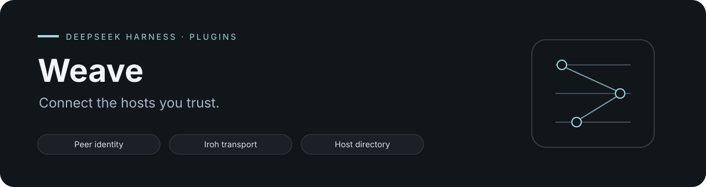
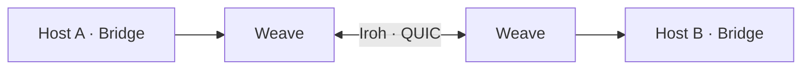

<div align="center">



# DSH Weave

[English](README.md) · [简体中文](README.zh.md)

[](https://www.npmjs.com/package/dsh-weave) [](LICENSE) [](https://github.com/topics/dsh-plugin)

</div>

Connect explicitly trusted DeepSeek Harness hosts through Iroh. Keep pairing, peer identity, reachability, and the remote session directory in one transport layer.

## What you get

| Capability | Behavior |
| --- | --- |
| **Persistent identity** | The same host identity survives restarts. |
| **Explicit pairing** | Exchange endpoint tickets and trust each peer locally. |
| **Encrypted transport** | Iroh provides QUIC connections, direct paths, and relay fallback. |
| **Remote directory** | Discover workspaces and sessions on paired hosts. |
| **Visible state** | Host reachability is separate from agent idle/running/offline state. |
| **Native settings** | Grouped identity and pairing controls, copy feedback, and removal confirmation. |

## Quick start

On each host:

```bash
dsh plugin --profile web add dsh-weave@latest
dsh web
```

1. Open **Settings → Weave** on both hosts.
2. Exchange their tickets through a channel you trust.
3. Add and explicitly trust the other host's ticket on each side.
4. Use a higher-level plugin such as [DSH Chat](https://github.com/baixianger/dsh-chat) to select remote sessions.

Add [DSH Bridge](https://github.com/baixianger/dsh-bridge) when messages should reach local agents on a receiving host. Bridge is optional for transport startup.

## One transport, separate responsibilities



Iroh owns encrypted connectivity. Weave owns host trust, endpoint refresh, reachability, and authenticated requests. Chat owns rooms, membership, and room capabilities. Knowing a ticket alone does not grant trust or agent access.

## Configuration

| Field | Default | Purpose |
| --- | --- | --- |
| `hostName` | System hostname | Display label for the host. |
| `relayMode` | `default` | Iroh default relay selection, or `disabled`. |
| `persistIdentity` / `persistPeers` | `true` | Keep identity and trusted peers across restarts. |
| `acknowledgementTimeoutMs` | `10000` | Default acknowledgement deadline. |
| `maxConcurrentInbound` | `64` | Bound concurrent incoming requests. |
| `shutdownTimeoutMs` | `1000` | Bound transport shutdown. |

Identity and trusted peers are stored under `$DSH_HOME/dsh-weave` (`~/.dsh` by default), with owner-only permissions. `identityPath` and `peersPath` can override their locations.

## Cancellation & delivery

Outbound requests accept a cancellation signal. Cancellation closes their connection; the receiving listener is also notified when the peer disconnects. Cancelling a request does not mark an otherwise reachable host offline. Chat's longer polling requests use matching acknowledgement deadlines.

The current release is a **transport MVP**. It provides pairing, directory access, and authenticated request delivery. A general remote task approval workflow and durable transport outbox/reconnect replay are not implemented. Application-level persistence belongs to the consuming plugin.

## Protocol & architecture

[Architecture](docs/ARCHITECTURE.md) · [Protocol](docs/PROTOCOL.md) · [Security](docs/SECURITY.md) · [Room authority](docs/ADR-001-authoritative-chat-rooms.md)

The design documents include planned capabilities; use this README and the release notes for current behavior.

## Development & feedback

```bash
npm ci
npm run check
```

[Report an issue](https://github.com/baixianger/dsh-weave/issues) · [Release notes](RELEASES.md) · [MIT license](LICENSE)
