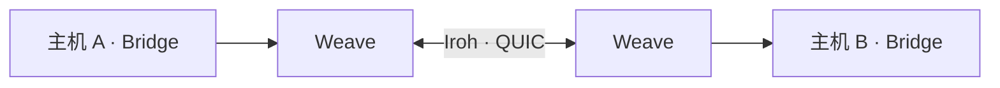

<div align="center">


# DSH Weave

[English](README.md) · [简体中文](README.zh.md)

[](https://www.npmjs.com/package/dsh-weave) [](LICENSE) [](https://github.com/topics/dsh-plugin)

</div>

通过 Iroh 连接明确受信任的 DeepSeek Harness 主机。由一个传输层统一处理配对、身份、可达状态和远程会话目录。

## 主要能力

| 能力 | 行为 |
| --- | --- |
| **持久身份** | 重启后保持同一个主机身份。 |
| **明确配对** | 交换 endpoint ticket，并在本机信任对端。 |
| **加密传输** | Iroh 提供 QUIC 连接、直连路径和中继回退。 |
| **远程目录** | 查看配对主机的工作区与会话。 |
| **可见状态** | 区分主机可达性与 Agent 的空闲、运行、离线状态。 |
| **原生设置** | 分组展示身份与配对操作，提供复制反馈和移除确认。 |

## 快速开始

在每台主机执行：

```bash
dsh plugin --profile web add dsh-weave@latest
dsh web
```

1. 在两台主机打开 **设置 → Weave**。
2. 通过可信渠道交换双方 ticket。
3. 在各自页面添加并明确相信对方的 ticket。
4. 在 [DSH Chat](https://github.com/baixianger/dsh-chat) 等上层插件中选择远程会话。

如果消息需要到达接收主机上的本地 Agent，再安装 [DSH Bridge](https://github.com/baixianger/dsh-bridge)。传输层启动不强制依赖 Bridge。

## 各层职责



Iroh 负责加密连接；Weave 负责主机信任、endpoint 刷新、可达状态和认证请求；Chat 负责房间、成员和房间权限。仅知道 ticket 不代表获得信任或 Agent 访问权限。

## 配置

| 字段 | 默认值 | 用途 |
| --- | --- | --- |
| `hostName` | 系统主机名 | 主机显示名称。 |
| `relayMode` | `default` | Iroh 默认中继选择，或 `disabled`。 |
| `persistIdentity` / `persistPeers` | `true` | 重启后保留身份与受信任主机。 |
| `acknowledgementTimeoutMs` | `10000` | 默认确认等待期限。 |
| `maxConcurrentInbound` | `64` | 入站请求并发上限。 |
| `shutdownTimeoutMs` | `1000` | 传输层关闭等待上限。 |

身份和信任记录保存在 `$DSH_HOME/dsh-weave`，默认位于 `~/.dsh`，仅所有者可访问。可以通过 `identityPath`、`peersPath` 指定位置。

## 取消与投递

出站请求接受取消信号。取消会关闭连接；对端断开时，接收侧监听器也会收到通知。取消单次请求不会把仍可达的主机误判为离线。Chat 的较长轮询会使用匹配的确认等待期限。

当前是 **传输 MVP**，提供配对、目录访问和认证请求投递。通用远程任务审批、持久传输 outbox 和重连回放尚未实现；应用级持久化由使用它的插件负责。

## 协议与架构

[架构](docs/ARCHITECTURE.md) · [协议](docs/PROTOCOL.md) · [安全模型](docs/SECURITY.md) · [房间权威主机](docs/ADR-001-authoritative-chat-rooms.md)

设计文档包含规划中的能力；当前行为以本 README 和版本记录为准。

## 开发与反馈

```bash
npm ci
npm run check
```

[提交问题](https://github.com/baixianger/dsh-weave/issues) · [版本记录](RELEASES.md) · [MIT 许可证](LICENSE)
