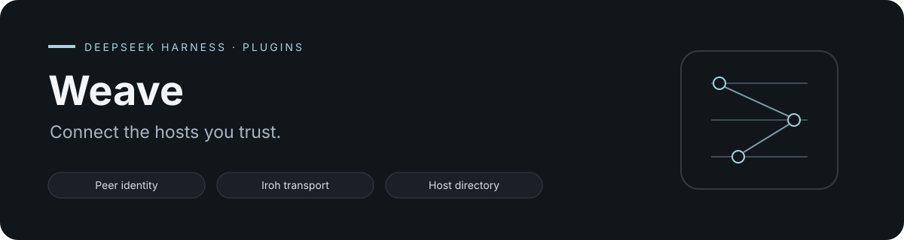
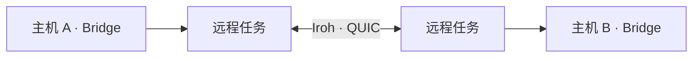

<div align="center">



# DSH Remote Task

[English](README.md) · [简体中文](README.zh.md)

[](LICENSE) [](https://github.com/topics/dsh-plugin)

</div>

通过 Iroh 连接明确受信任的 DeepSeek Harness 主机，把任务发到另一台机器的会话，并在右侧面板跟进进度。配对一次即可。

## 主要能力

| 能力 | 行为 |
| --- | --- |
| **持久身份** | 重启后保持同一个主机身份。 |
| **明确配对** | 交换 endpoint ticket，并在本机信任对端。 |
| **加密传输** | Iroh 提供 QUIC 连接、直连路径和中继回退。 |
| **远程目录** | 查看配对主机的工作区与会话。 |
| **远程任务** | 在当前会话把任务派给配对设备，在右侧面板跟进心跳、进度和结果。 |
| **可见状态** | 区分主机可达性与 Agent 的空闲、运行、离线状态。 |
| **原生设置** | 分组展示身份与配对操作，提供复制反馈和移除确认。 |

## 远程任务

远程任务已经内置在本包里，不再需要单独安装 `dsh-weave-link`。在 DSH 会话里可以：

- 用 `link_devices` 查看哪些配对设备在线、各有哪些会话；
- 用 `link_task` 给一台或多台设备派任务；
- 用 `link_tasks` 查看任务详情、消息、心跳和结果。

右侧 **远程任务** 面板是聊天窗口式：任务列表、带作者和时间的对话、底部派任务抽屉。只显示当前会话。设置页的 **远程任务** 是唯一入口：配对、设备改名、每台设备的默认工作区、心跳规则、新对话默认项目都在这里。收到文件会自动落到当前对话项目文件夹下的「收到文件」子目录。

派任务没指定会话时，默认让对方**新开一个会话**接活，不会塞进它正在用的对话里；给某台设备选了默认工作区时按工作区走。设置页可以关掉「默认开新会话」回到老行为。

任务记录跟着对话走：每个会话目录下一个 `weave-tasks.json`，删对话就一起删。失败只有一个状态；插件会看失败内容，像是临时问题就在同一个任务里自动换方式重试，最多 2 次，其他情况停下来汇报。

## 快速开始

在每台主机执行：

```bash
# 从 Releases 下载 dsh-remote-task.tgz，然后：
dsh plugin --profile web add ./dsh-remote-task.tgz
dsh web
```

1. 在两台主机打开 **设置 → 远程任务**。
2. 通过可信渠道交换双方 ticket。
3. 在各自页面添加并明确相信对方的 ticket。
4. 在 [DSH Chat](https://github.com/baixianger/dsh-chat) 等上层插件中选择远程会话。

如果消息需要到达接收主机上的本地 Agent，再安装 [DSH Bridge](https://github.com/baixianger/dsh-bridge)。传输层启动不强制依赖 Bridge。

## 各层职责



Iroh 负责加密连接；传输层（原 Weave）负责主机信任、endpoint 刷新、可达状态和认证请求；Chat 负责房间、成员和房间权限。仅知道 ticket 不代表获得信任或 Agent 访问权限。

## 配置

| 字段 | 默认值 | 用途 |
| --- | --- | --- |
| `hostName` | 系统主机名 | 主机显示名称。 |
| `relayMode` | `default` | Iroh 默认中继选择，或 `disabled`。 |
| `persistIdentity` / `persistPeers` | `true` | 重启后保留身份与受信任主机。 |
| `acknowledgementTimeoutMs` | `10000` | 默认确认等待期限。 |
| `maxConcurrentInbound` | `64` | 入站请求并发上限。 |
| `shutdownTimeoutMs` | `1000` | 传输层关闭等待上限。 |

身份和信任记录保存在 `$DSH_HOME/dsh-weave`，默认位于 `~/.dsh`，仅所有者可访问。这个目录沿用 dsh-weave，改名后原有配对不会丢。可以通过 `identityPath`、`peersPath` 指定位置。

## 取消与投递

出站请求接受取消信号。取消会关闭连接；对端断开时，接收侧监听器也会收到通知。取消单次请求不会把仍可达的主机误判为离线。Chat 的较长轮询会使用匹配的确认等待期限。

当前版本同时包含传输层 MVP 和远程任务层：配对、目录、认证投递、任务派发、心跳查看、会话任务卡都已实现。持久传输 outbox 和重连回放仍未实现；任务完成依赖接收方 Agent 按约定回复 `[任务完成 #id]` 标记。

## 协议与架构

[架构](docs/ARCHITECTURE.md) · [协议](docs/PROTOCOL.md) · [安全模型](docs/SECURITY.md) · [房间权威主机](docs/ADR-001-authoritative-chat-rooms.md)

设计文档包含规划中的能力；当前行为以本 README 和版本记录为准。

## 开发与反馈

```bash
npm ci
npm run check
```

[提交问题](https://github.com/zddzhangdada/dsh-remote-task/issues) · [版本记录](RELEASES.md) · [MIT 许可证](LICENSE)

---

**基于 dsh-weave：** 本项目基于 [dsh-weave](https://github.com/baixianger/dsh-weave)，最早由 [Xiang Bai](https://github.com/baixianger) 创建。从 0.3.7 起改名为 `dsh-remote-task`，名字更直接地说明实际功能：把任务发到另一台 DSH 主机的会话并读回进度。原仓库仍可查阅。
